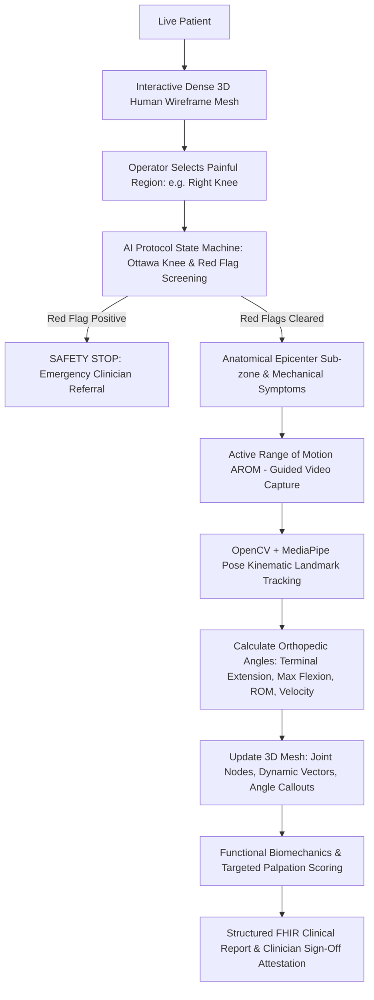

# AI-Driven Physical Examination System
### Computer Vision Biomechanics • MediaPipe Pose • React Three Fiber 3D Mesh • FastAPI

An end-to-end, clinically grounded physical examination system built using **Python, FastAPI, OpenCV, MediaPipe, React, and Three.js (React Three Fiber)**. 

The **AI strictly controls the examination workflow** through a clinical state machine based on validated medical protocols (Ottawa Knee Rules and AAOS guidelines). The operator follows AI directives, communicates verbatim questions to the patient, records movement videos, inputs responses, and transmits evidence for automated biomechanical analysis.

---

## 🏗️ System Architecture & Workflow



---

## 🔬 Clinical Protocols & Safety Guarantees

### 1. Validated Knee Pain Examination Protocol
- **Phase 1: Red Flag Safety Screening (Emergency Abort)**
  - **Ottawa Knee Rule**: Acute trauma with inability to bear weight for 4 steps (immediate and present). Positive triggers acute fracture alert and halts examination.
  - **Infection / Septic Joint Screen**: Localized hyperthermia, rapid effusion (<4h), and fever/chills. Positive triggers suspected septic arthritis emergency referral.
  - **Neurovascular Integrity**: Common peroneal nerve weakness (foot drop) or absent distal dorsalis pedis pulse. Positive triggers acute neurovascular referral.
- **Phase 2: Pain Epicenter Localization & Mechanical Symptoms**
  - Sub-zone localization: Anterior (Patellofemoral/tendon), Medial Joint Line (Meniscus/MCL), Lateral Joint Line (LCL/IT band), Posterior (Baker's cyst).
  - Mechanical locking/jamming vs. giving way/ligamentous instability.
- **Phase 3: Active Range of Motion (AROM) Kinematics**
  - 90° Sagittal profile video capture.
  - Automatic extraction of Hip, Knee, and Ankle spatial vectors.
  - Kinematic curve $\theta(t)$, terminal extension deficit ($0^\circ-5^\circ$ normal), maximum active flexion ($130^\circ-145^\circ$ normal), and angular velocity ($\text{deg/s}$).
- **Phase 4: Functional Provocative Biomechanics**
  - Frontal (Coronal) view: shallow squat / sit-to-stand evaluating medial dynamic knee valgus collapse and pelvic tilt.
- **Phase 5: Targeted Palpation & Scoring**
  - Focal joint line tenderness on 0–10 Numeric Rating Scale (NRS).
- **Phase 6: Clinical Synthesis & Attestation**
  - Synthesized clinical report for licensed clinician sign-off.

### 2. Regulatory & Non-Diagnostic Notice
> [!IMPORTANT]
> This system provides **objective computer vision kinematic metrics and structured protocol responses for clinical decision support**. It **never autonomously diagnoses medical conditions or prescribes medications**. Final diagnosis must be confirmed by a licensed clinician.

---

## 📐 Kinematic Math & Computer Vision Pipeline

Given tracked 3D landmarks $\mathbf{P}_{\text{hip}}$, $\mathbf{P}_{\text{knee}}$, and $\mathbf{P}_{\text{ankle}}$ from MediaPipe Pose:

$$\vec{u} = \mathbf{P}_{\text{hip}} - \mathbf{P}_{\text{knee}}, \quad \vec{v} = \mathbf{P}_{\text{ankle}} - \mathbf{P}_{\text{knee}}$$

$$\theta_{\text{included}} = \arccos\left(\frac{\vec{u} \cdot \vec{v}}{\|\vec{u}\| \|\vec{v}\|}\right)$$

$$\theta_{\text{flexion}} = 180^\circ - \theta_{\text{included}}$$

- **Noise Filtering**: Moving average / Savitzky-Golay smoothing to eliminate camera jitter without phase lag.
- **Reliability Metric**: Mean landmark visibility confidence thresholded at 0.55. Consecutive low-confidence frames flag partial occlusion and generate clinical quality warnings.
- **Dynamic Arc Visualization**: 3D joint nodes, connecting vectors, and live floating HTML billboards rendered directly in Three.js space.

---

## 📁 Repository Structure

```
c:\Body_calibration\
├── backend\
│   ├── app\
│   │   ├── api\
│   │   │   └── endpoints.py          # FastAPI REST endpoints
│   │   ├── config.py                 # Settings, paths, thresholds
│   │   ├── database.py               # SQLAlchemy SQLite/PostgreSQL engine
│   │   ├── main.py                   # FastAPI application entrypoint
│   │   ├── models\
│   │   │   └── examination.py        # Database models (Examination, Step, Measurement, Finding)
│   │   ├── protocols\
│   │   │   ├── base.py               # Protocol step dataclass definitions
│   │   │   └── knee_protocol.py      # Validated Knee Examination Protocol
│   │   ├── schemas\
│   │   │   └── examination.py        # Pydantic serialization models
│   │   ├── services\
│   │   │   ├── engine.py             # State machine orchestrator & CV trigger
│   │   │   └── report_generator.py   # FHIR structured report compiler
│   │   └── vision\
│   │       └── pose_tracker.py       # MediaPipe Pose analyzer & synthetic kinematics
│   ├── models\
│   │   └── pose_landmarker_full.task # Google MediaPipe Pose 1.x model asset
│   ├── requirements.txt              # Python dependencies
│   └── test_e2e_workflow.py          # 13-point automated integration test suite
│
├── frontend\
│   ├── src\
│   │   ├── components\
│   │   │   ├── AIWorkflow\
│   │   │   │   └── AIWorkflowPanel.tsx          # AI directives, webcam recording & operator controls
│   │   │   ├── BiomechanicalAnalytics\
│   │   │   │   └── BiomechanicalPanel.tsx       # Live angle curve θ(t), ROM, confidence metrics
│   │   │   ├── ClinicalReport\
│   │   │   │   └── ClinicalReportModal.tsx      # FHIR structured report & clinician sign-off
│   │   │   └── ThreeBodyMesh\
│   │   │       ├── BodyMeshViewer.tsx           # Three.js Canvas container with camera presets
│   │   │       └── DenseHumanMesh.tsx           # 3D dense anatomical wireframe mesh & joint nodes
│   │   ├── services\
│   │   │   └── api.ts                           # REST API client
│   │   ├── types\
│   │   │   └── examination.ts                   # TypeScript interfaces
│   │   ├── App.tsx                              # Main application layout
│   │   └── index.css                            # Modern cyber-medical dark theme
│   ├── package.json
│   └── tsconfig.json
└── README.md
```

---

## 🚀 Setup & Execution Guide

### Prerequisites
- Python 3.10+
- Node.js 18+ (v22 tested)
- npm 9+

### 1. Backend Setup & Startup
```powershell
# Navigate to backend directory
cd c:\Body_calibration\backend

# Install dependencies
pip install -r requirements.txt

# Run full end-to-end integration test suite
python test_e2e_workflow.py

# Launch FastAPI backend server (Runs on port 8000)
python -m uvicorn app.main:app --host 0.0.0.0 --port 8000 --reload
```
API Documentation will be live at: `http://localhost:8000/docs`

### 2. Frontend Setup & Startup
```powershell
# Navigate to frontend directory
cd c:\Body_calibration\frontend

# Install dependencies
npm install

# Build production bundle
npm run build

# Start local development server (Runs on port 5173)
npm run dev -- --host --port 5173
```
Open your browser at: `http://localhost:5173`

---

## 🩺 Key Features Walkthrough

1. **Interactive 3D Body Mesh**:
   - Dense wireframe anatomy with clickable joint zones (Right Knee, Left Knee, Lumbar Spine, Hips, Shoulders).
   - Camera angle preset toolbar: Frontal (Coronal), Right Profile (Sagittal), Left Profile, Posterior, and Camera Reset.
2. **AI-Directed Workflow**:
   - Clear distinction: **AI Directive for Operator** vs. **Question for Patient (Verbatim)**.
   - Text-to-Speech audio readout for patient questions.
   - Operator input controls tailored to active step: Boolean Yes/No, Anatomical Sub-zones, Webcam Video Recorder, File Upload, Instant Synthetic Kinematics Demo, 0-10 NRS Tenderness Slider.
3. **Safety & Red Flag System**:
   - Immediate examination abort if Ottawa fracture rule, septic arthritis, or neurovascular compromise is flagged.
   - Distinct red banner providing clinical referral instructions.
4. **Computer Vision Kinematics**:
   - MediaPipe Pose joint tracking on patient video.
   - Real-time kinematic curve $\theta(t)$, active ROM, terminal extension deficit, and angular velocity.
   - 3D joint nodes and angle callouts floating directly on the 3D mesh.
5. **Structured Clinical Report & Attestation**:
   - Categorized evidence: Patient-Reported Symptoms, Computer-Vision Observations, Objective Measurements, Red Flags Cleared Status.
   - Clinician Review & Attestation Sign-Off form (Doctor name, Medical license #, Impression, Plan, Sign & Lock).
